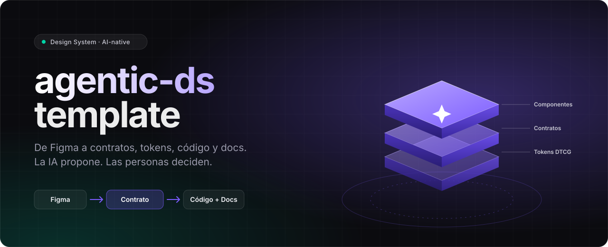

<p align="center">
  
</p>

<h1 align="center">agentic-ds template</h1>

<p align="center">
  Plantilla para llevar un sistema de diseño de <b>Figma</b> a <b>contratos</b>, tokens, código y documentación,<br>
  con un flujo agéntico: una IA lee, propone y genera; las personas deciden.
</p>

<p align="center">
  
  
  
  
  
  
  
</p>

<p align="center">
  <a href="docs/guia/README.md"><b>Guía</b></a> ·
  <a href="AGENTS.md">Reglas para la IA</a> ·
  <a href="GOBERNANZA.md">Gobernanza</a> ·
  <a href="#empezar">Empezar</a>
</p>

---

```
Figma ──► contrato (fuente de verdad) ──► código + documentación
   └────► tokens DTCG ─────────────────────┘
```

Es **agnóstica** (cualquier stack) y empieza **vacía**: solo trae reglas, plantillas, scripts y skills. Todo lo demás lo genera la IA desde **tu** Figma.

---

## Idea en 4 líneas

1. **El contrato es la fuente de verdad.** Figma se lee; el código se genera.
2. **Tokens en capas** (primitivo → semántico → componente). Los componentes nunca usan primitivos.
3. **Lo que no se puede leer no se inventa:** `null` + `needsReview`.
4. **La IA propone, el dueño aprueba.** Hooks y `npm run check` lo hacen cumplir.

---

## Requisitos

- Node 20+. Sin dependencias: no hace falta `npm install`.
- [Claude Code](https://claude.com/claude-code) (u otro agente: las reglas están en `AGENTS.md`).
- Un puente con Figma, uno de:

| Puente | Qué da |
|---|---|
| `figma-console` (recomendado) | Plugin API completa. Único que permite `ds-figma-build` |
| `figma-mcp` | MCP oficial de Figma. Variables solo por nodo |
| `export-json` | Un archivo exportado |

## Empezar

```bash
npm run check
```

Debe salir ✔ con todo vacío. Después, en Claude Code, escribe:

> **Configura el sistema**

La IA activa la skill que toca en cada momento. No hace falta nombrarlas.

---

## El recorrido

Cuatro fases. **Respeta el orden**: cada skill exige la anterior.

| Fase | # | Skill | Qué hace | Produce |
|---|---|---|---|---|
| **A · Preparar** | 1 | `ds-setup` | Configura nombre, prefijo, Figma, stack, modos y dueño. Comprueba cómo leer Figma | `ds.config.json`, `contracts/vocabulary.json` |
| | 2 | `ds-figma-audit` | Lee Figma y separa lo medido de lo inferido. Termina con preguntas abiertas | `docs/auditoria/` |
| | 3 | `ds-decide` | Convierte cada pregunta en un ADR (contexto, decisión, consecuencias, alternativas) | `docs/adr/` |
| **B · Fundamentos** | 4 | `ds-tokens` | Variables de Figma → tokens DTCG en 3 capas, un archivo por modo | `tokens/` → `tokens.css` |
| | 5 | `ds-icons` | Elige la librería de iconos y registra solo los usados | `icons/registry.json`, contrato `Icon` |
| **C · Por componente** | 6 | `ds-contract` | Lee un component set y escribe su contrato: props, estados, anatomía, a11y, tokens | `contracts/components/<N>/` |
| | 7 | `ds-component` | Genera el código desde el contrato, en tu stack | `src/components/<n>/` |
| **D · Mantener** | 8 | `ds-sync` | Compara Figma con lo existente y propone cambios con su versión y CHANGELOG | Versiones nuevas |

La fase C es un **bucle**: repítela por cada componente.

### Skills opcionales

| Skill | Para qué |
|---|---|
| `ds-spec` | Contrato de un componente que **no existe en Figma**, desde una descripción. Queda `draft` e `inferred` |
| `ds-figma-build` | Dirección inversa: del contrato a Figma (variantes, capas, variables). Requiere `figma-console` |
| `ds-handoff` | Cierra la sesión: resume lo hecho y lo pendiente en `docs/sesiones/` |

### Requisitos por skill

| Skill | Necesita antes |
|---|---|
| `ds-figma-audit` | `ds-setup` |
| `ds-decide` | Una auditoría o una decisión pendiente |
| `ds-tokens` | ADRs de tokens y modos |
| `ds-icons` | Tokens `icon.size.*` y ADR de iconos |
| `ds-contract` | Tokens (e `Icon` si el componente usa iconos) |
| `ds-component` | Contrato en `review` o `stable` |
| `ds-sync` | Contratos y tokens existentes |

Guía paso a paso con ejemplos y ejercicios: **[docs/guia/](docs/guia/README.md)**.

---

## Comandos

| Comando | Hace |
|---|---|
| `npm run check` | Valida todo contra `schemas/` y las reglas de `AGENTS.md` |
| `npm run check:self` | Valida los ejemplos de `schemas/fixtures/` |
| `npm run tokens` | `tokens/*.json` → `tokens/build/tokens.css` y `tokens.json` |
| `npm run docs` | Contratos → `docs/components/`, índices y `llms.txt` |
| `npm run new -- <tipo> <nombre>` | Copia una plantilla: `contract`, `adr`, `audit`, `theme`, `tokens`, `icons`, `vocabulary` |

## Estructura

| Ruta | Qué es | ¿Se edita? |
|---|---|---|
| `ds.config.json` | Identidad del sistema | Sí (`ds-setup`) |
| `schemas/` | Las reglas: formas válidas y fixtures de ejemplo | Solo con un ADR |
| `templates/` | Plantillas que copian las skills | No |
| `tokens/` | Fuentes: `primitive`, `semantic`, `component`, `themes/` | Sí, con aprobación |
| `tokens/build/` | CSS y JSON compilados | **Nunca** (`npm run tokens`) |
| `icons/` | Registro de iconos | Sí (`ds-icons`) |
| `contracts/` | `vocabulary.json` y un contrato + CHANGELOG por componente | Sí |
| `src/components/` | Código generado desde los contratos | Sí (`ds-component`) |
| `docs/adr/` | Decisiones | Sí (`ds-decide`) |
| `docs/auditoria/` | Informes de auditoría | Sí (`ds-figma-audit`) |
| `docs/components/`, `llms.txt` | Documentación generada | **Nunca** (`npm run docs`) |
| `docs/guia/` | Guía del alumno | — |
| `.claude/` | Skills y hooks | — |
| `scripts/` | Node sin dependencias | — |
| `AGENTS.md` | Reglas para cualquier IA | — |
| `GOBERNANZA.md` | Roles, ADRs, versiones y estados | — |

## Qué tener en cuenta

**Estados del contrato** (los comprueba `check`):

`draft` → `review` → `stable` → `deprecated`

- `review` exige propósito, a11y, teclado y **nada `inferred`**.
- `stable` exige además `needsReview` vacío y ningún token `null`.

**Versiones del contrato (semver):** *patch* = textos · *minor* = algo nuevo · *major* = renombrar o quitar (requiere ADR). Cada versión lleva su entrada en el CHANGELOG.

**Procedencia de cada dato:** `measured` (leído de Figma) · `inferred` (redactado por la IA) · `decided` (confirmado por una persona o un ADR).

**Reglas que la IA cumple al generar código:**

- Props exactamente como en el contrato; no se añaden.
- Solo tokens semánticos o de componente. Sin hex ni px sueltos.
- Dark mode con `[data-theme]`, nunca con valores distintos.
- Disabled con tokens `*.disabled`, nunca con `opacity`.
- Hover, focus, breakpoints y modos nunca son props.
- Cada parte de `anatomy` lleva `data-part`. Comportamiento según WAI-ARIA.

**Hooks** (`.claude/settings.json`):

- *Antes de escribir:* bloquea archivos generados y pide aprobación para tokens, vocabulario, esquemas, plantillas, reglas y contratos en `review` o `stable`.
- *Después de escribir:* ejecuta `check`; si falla, la IA debe corregir.

**CI:** `.github/workflows/check.yml` ejecuta `check:self` y `check` en cada push y PR.

## Principios (ADRs 0001–0005)

1. El contrato es la fuente de verdad.
2. Tokens DTCG en capas.
3. Siete clases de propiedad de Figma.
4. Comportamiento con patrones WAI-ARIA.
5. Lo que no se puede leer, no se inventa.

---

## Usar como plantilla

En GitHub: **Settings → General → Template repository**. Después, cada alumno pulsa **Use this template**, clona su copia y empieza con un repo vacío y en verde.

```bash
git clone <tu-repo>
cd <tu-repo>
npm run check
claude
```

---

## Licencia

Creado por **Xavier Pascual**. Licencia [MIT](LICENSE): puedes usarlo, copiarlo y adaptarlo, manteniendo el aviso de copyright.
